<p align="center">
  
</p>

<h1 align="center">Proofy — 지급정지 이의제기 서류 준비 도우미</h1>

<p align="center">
  사기 피해금이 입금되어 계좌가 지급정지된 청년이<br />
  은행에 낼 <b>이의제기 서류를 직접 준비하도록 돕는 웹앱</b>
</p>

### 🏆 2026 대한민국 청년 CAREER FAIR AI 해커톤 출품작

> [Proofy 바로가기](https://proofy-app.pages.dev) | [시연 영상](https://youtu.be/Pp6n4oEeSkQ) | [Backend 저장소](https://github.com/proofy-ai/proofy-server)

<br>

## 🗺 프로젝트 소개

**Proofy**는 사기 피해금이 입금되어 계좌가 **지급정지**된 청년이, 은행에 낼 **이의제기 서류를 직접 준비하도록 돕는 웹앱**입니다.

지급정지를 풀려면 명의인이 "사기에 쓰인 계좌가 아니다"를 서류로 소명해야 하는데, 필요한 서류도, 소명서 쓰는 법도, 기한(공고일 기준 2개월)도 알기 어렵습니다.

Proofy는 사연과 서류를 AI가 읽고 맞대어 보고, 부족한 사실은 되묻습니다. 결과로 **소명서 초안, 부족한 서류 목록, 이의제기신청서 PDF**를 만듭니다. 심사는 은행이 하며 **AI는 해제 여부를 판정하지 않습니다.** 시연용 프로토타입이라 합성 데이터만 씁니다.

### 주요 기능

- 🧭 이의제기 기한 D-day
- 🔎 AI의 조사 계획과 조회 과정 공개
- 💬 AI 질문에 답하고 다시 분석
- ✅ 증빙 대응표 (맞음 / 어긋남 / 진술만 있음)
- 📂 부족한 서류 목록
- ✍️ 소명서 초안과 프루피 조언
- 📝 이의제기신청서 미리보기와 PDF 저장
- 🙋 체험 계정으로 샘플 사건 바로 시작
- ♿ 큰글씨·다크 모드

<br>

## 🚩 프로젝트 개요

| 항목       | 내용                                                |
| ---------- | --------------------------------------------------- |
| 프로젝트명 | Proofy                                              |
| 주제       | 지급정지된 계좌의 이의제기 서류 준비를 돕는 AI 웹앱 |
| 출품       | 2026 대한민국 청년 CAREER FAIR AI 해커톤            |
| 개발 기간  | 2026.11                                             |
| 성격       | 시연용 프로토타입 (합성 데이터만 사용)              |

<br>

## 👩🏻‍🤝‍🧑🏻 MEMBERS

<table>
  <tr>
    <td align="center" width="160">
      <a href="https://github.com/YounaJ00"></a><br />
      <b>주유나</b><br />
      <code>FE</code>
    </td>
    <td align="center" width="160">
      <a href="https://github.com/HyunGyu-Cho"></a><br />
      <b>조현규</b><br />
      <code>BE</code>
    </td>
  </tr>
</table>

<br>

## 🛠 Tech Stack

<!-- prettier-ignore-start -->

### Frontend

<p align="center">

| Language & Framework | Routing & Data | State |
|:---:|:---:|:---:|
|   |   |  |

| Styling | Build | Test & Mock |
|:---:|:---:|:---:|
|  |  |   |

| Code Quality | PDF |
|:---:|:---:|
|    |   |

</p>

### Backend

<p align="center">

| Framework | AI | Deploy |
|:---:|:---:|:---:|
|  |  |  |

</p>

### Deploy & Collaboration

<p align="center">


</p>


<!-- prettier-ignore-end -->

<br>

## 📸 서비스 화면

> 모바일 화면 기준이고, AI 분석 화면은 3배속이에요.

<table>
  <tr>
    <td align="center">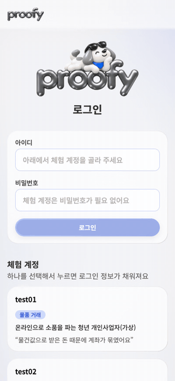</td>
    <td align="center">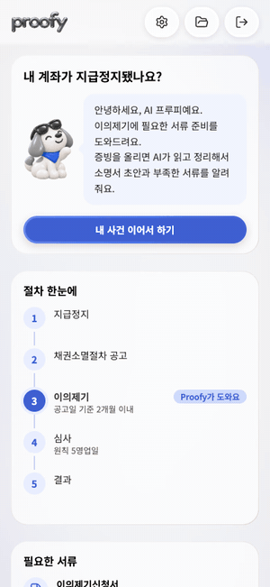</td>
    <td align="center">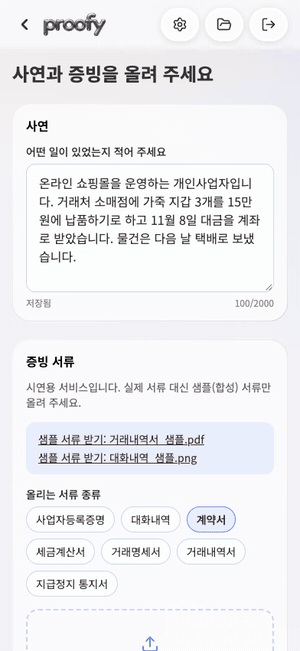</td>
  </tr>
  <tr>
    <td align="center"><b>로그인</b><br>체험 계정을 고르면 로그인 정보가 채워지고, 합성 서류가 담긴 샘플 사건으로 바로 시작해요.</td>
    <td align="center"><b>홈</b><br>지급정지 이후 절차와 필요한 서류를 카드로 안내해요.</td>
    <td align="center"><b>AI 분석</b><br>AI의 조사 계획과 조회 과정이 타임라인으로 하나씩 쌓여요.</td>
  </tr>
  <tr>
    <td align="center"></td>
    <td align="center">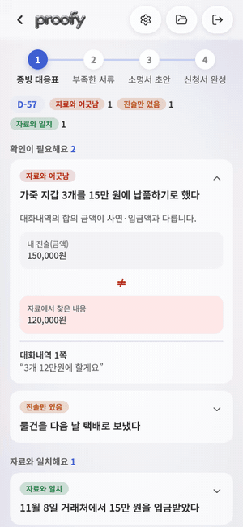</td>
    <td align="center">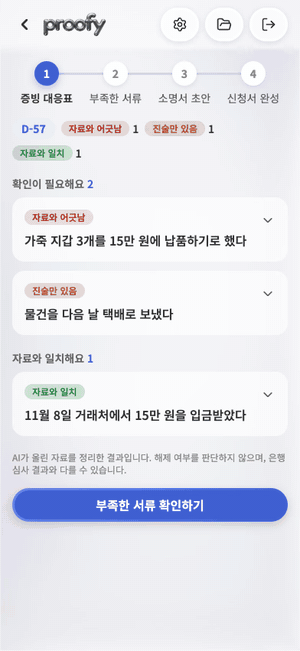</td>
  </tr>
  <tr>
    <td align="center"><b>질문 채팅</b><br>AI가 부족한 사실을 묻고, 답하면 반영해서 다시 분석해요.</td>
    <td align="center"><b>증빙 대응표</b><br>사연 속 주장을 자료와 맞음, 어긋남, 진술만 있음으로 정리하고 기한 D-day를 보여 줘요.</td>
    <td align="center"><b>부족한 서류</b><br>더 챙길 서류를 먼저 보여 주고, 따로 준비한 서류는 준비된 서류로 옮겨져요.</td>
  </tr>
  <tr>
    <td align="center">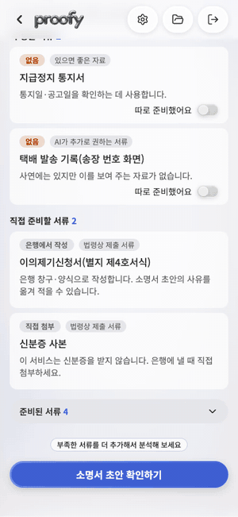</td>
    <td align="center">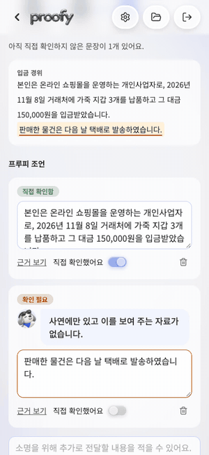</td>
    <td align="center">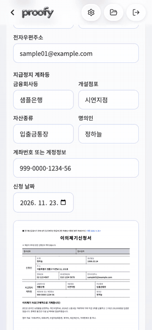</td>
  </tr>
  <tr>
    <td align="center"><b>소명서 초안</b><br>초안을 한 편으로 읽고, 확인이 필요한 문장은 하이라이트와 프루피 조언으로 확인해요.</td>
    <td align="center"><b>신청서 완성</b><br>신청인 정보를 입력하면 이의제기신청서 미리보기에 바로 반영돼요.</td>
    <td align="center"><b>PDF 저장</b><br>확인하지 않은 문장이 있으면 한 번 더 묻고, 저장 뒤 제출 방법을 안내해요.</td>
  </tr>
  <tr>
    <td align="center">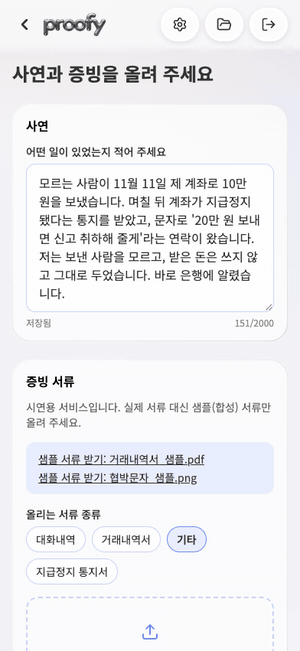</td>
    <td align="center"></td>
    <td align="center"><a href="docs/screens/13-pdf.png">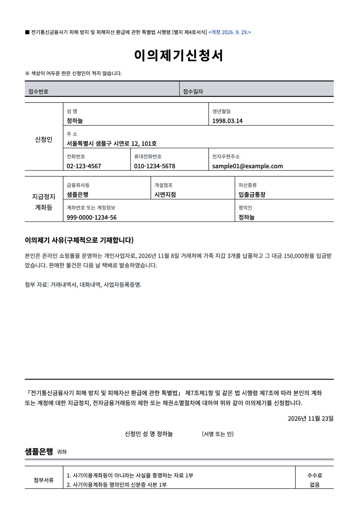</a></td>
  </tr>
  <tr>
    <td align="center"><b>내 사건</b><br>만든 사건을 모아 이어서 하기, 처음부터 다시, 삭제를 할 수 있어요.</td>
    <td align="center"><b>설정</b><br>큰글씨 모드와 다크 모드를 켜고 끌 수 있어요.</td>
    <td align="center"><b>PDF 최종본</b><br>완성한 이의제기신청서를 PDF로 받아요. 입력한 정보와 소명서 초안이 그대로 담겨요.</td>
  </tr>
</table>

<br />

### 📱 반응형 UI

> 모바일부터 데스크톱까지 화면 폭에 맞춰 레이아웃이 바뀌어요.

<p align="center">
  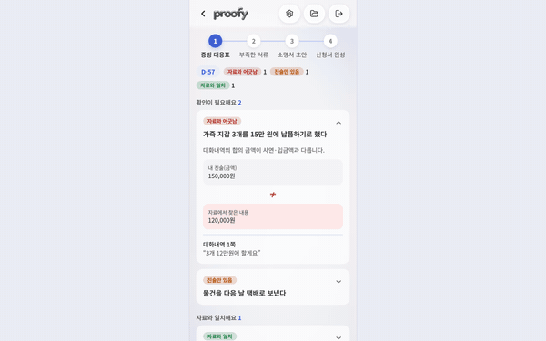
</p>

<br>

## 🔄 Frontend Architecture & Data Flow

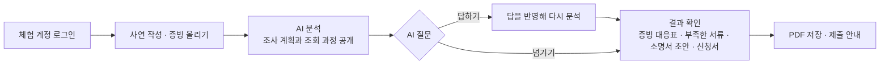

- **TanStack Query**로 서버 상태를, **Zustand**로 클라이언트 상태를 관리합니다.
- API 요청(`src/api`), 화면(`pages`, `components`), 상태(`store`)를 나눠 책임을 분리했습니다.
- 사건마다 발급되는 토큰을 `X-Case-Token` 헤더로 보냅니다.

<br>

## 💡 Frontend Design Decisions

- **분석 진행을 숨기지 않기:** 분석 상태를 1.5초마다 조회하고(최대 3분), AI가 한 일을 타임라인에 하나씩 쌓아 보여 줍니다.
- **서버 문장은 그대로, 표현은 프런트가:** 서버가 준 문장은 그대로 보여 주고, 라벨·아이콘·단계 이름·애니메이션은 프런트가 정합니다.
- **AI는 판정하지 않고 사용자가 확인:** 확인이 필요한 문장은 사용자가 직접 확인했다고 표시해야 하고, 확인하지 않은 채 PDF를 저장하려 하면 한 번 더 묻습니다.
- **개인정보를 남기지 않기:** 신청서에 적는 정보는 저장하지 않습니다. 브라우저에는 사건 목록과 사건별 토큰, 로그인 여부, 화면 설정만 저장합니다.
- **CSS만으로 만든 움직임:** 애니메이션 라이브러리 없이 Tailwind 키프레임과 `IntersectionObserver`로 만들고, 움직임 줄이기 설정을 따릅니다.
- **개발과 배포:** MSW 목 서버(`pnpm dev:mock`)로 백엔드 없이 전체 흐름을 확인하고, 폰트는 직접 제공하며 오래 캐시합니다. `main`에 올리면 Cloudflare Pages가 배포합니다.

<br>

## 📂 Frontend Folder Structure

```bash
src
├─ api                # API 요청 (사건, 분석, 증빙, 초안, 체크리스트)
├─ app                # 라우터, 진입 가드
├─ assets             # 이미지 (브랜드, 배경)
├─ components         # UI 컴포넌트
│  └─ common          # 버튼, 토글, 모달, 카드 등 공통 컴포넌트
├─ hooks              # 커스텀 훅 (분석 조회, 채팅, 초안 편집, PDF 등)
├─ layout             # 공통 레이아웃
├─ lib                # 순수 함수와 상수 (라벨, 기한, 초안 편집 등)
├─ mocks              # MSW 목 서버 (개발 전용)
├─ pages              # 화면 단위 (홈, 증빙, 분석, 채팅, 결과, 완료 등)
├─ store              # 전역 상태 (Zustand)
└─ types              # API 타입 정의
```

<br>

## 🗂 Repositories

| Repository |                            Link                             |
| :--------: | :---------------------------------------------------------: |
|  Frontend  |     [proofy-fe](https://github.com/proofy-ai/proofy-fe)     |
|  Backend   | [proofy-server](https://github.com/proofy-ai/proofy-server) |

<br>

## 🚀 Getting Started

> Node.js 22 이상과 pnpm 10을 권장합니다.

### 1. Clone Repository

```bash
git clone https://github.com/proofy-ai/proofy-fe.git
cd proofy-fe
```

### 2. Install Dependencies

```bash
pnpm install
```

### 3. Environment Variables

`.env.example`을 `.env.local`로 복사해서 사용합니다.

```bash
cp .env.example .env.local
```

| 변수              | 설명                                         |
| ----------------- | -------------------------------------------- |
| `VITE_API_ORIGIN` | 백엔드 서버 주소 (경로 `/api/v1` 제외)       |
| `VITE_USE_MOCK`   | `true`면 개발 서버에서 목 서버(MSW)를 켭니다 |

### 4. Run Development Server

```bash
pnpm dev        # 백엔드 서버에 연결
pnpm dev:mock   # 목 서버로 실행 (백엔드 없이 전체 흐름 확인)
```

브라우저에서 `http://localhost:5173`으로 접속합니다.

### 5. Test & Build

```bash
pnpm test       # 단위 테스트
pnpm lint       # 린트
pnpm build      # 타입 검사 후 빌드
pnpm preview    # 빌드 결과 미리보기
```
